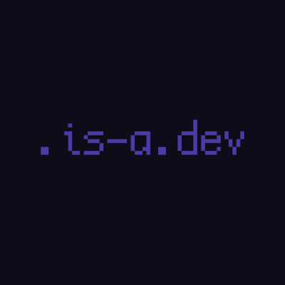

<p align="center">
  
</p>

<div align="center">

# is-a.dev Review Dash

A fast, Material Design 3 (Expressive) reviewer dashboard for reviewing pull requests on [is-a-dev/register](https://github.com/is-a-dev/register) and [is-a.bot](https://is-a.bot).

[](https://github.com/linuskang/review-dash/actions/workflows/ci.yml)
[](LICENSE)

</div>

---

## Overview

The standard GitHub web interface can be cumbersome when reviewing dozens of domain registration PRs per day. **is-a.dev Review Dash** streamlines the review queue with real-time CI status, automated PR template parsing, live embedded site previews, pre-seeded canned responses for rejection reasons, and one-click actions.

## Features

- **Queue Management**: Oldest-to-newest ordering of open pull requests with instant metadata, labels, comment counters, and aggregate check indicators.
- **Automated Requirement Validation**: Parses PR checklist items, purpose statements, and preview URLs directly from PR templates with unticked requirements highlighted.
- **Live Preview Sandbox**: Embedded, sandboxed preview iframe of contributor sites with referrer protection and same-origin isolation.
- **Workflow & Check Management**:
  - Combined view of commit check runs and GitHub Actions workflow runs.
  - One-click maintainer approval for first-time contributor workflows held by GitHub.
  - Direct log extraction and parsing for failed CI jobs.
- **Discussion & Canned Responses**: Timeline view with author/bot badges, reply composer, and editable canned responses matched to repo `reason:*` labels.
- **Labels Editor**: Real-time label picker grouped into status, reason, CI, and custom tags.
- **Actions & Auto-Advance**: Close with optional canned responses, approve, or approve-and-merge (merge commit / rebase). Automatically jumps to the next pending PR upon completion.
- **Design & Theme**: Material Design 3 Expressive UI built with MUI v9, dark/light theme switching with persistence, and Framer Motion spring transitions.

## Architecture & Security

- **Server-Side Token Storage**: GitHub tokens are never passed to or stored in client-side storage. Sessions are encrypted using AES-256-GCM sealed into an `httpOnly`, `SameSite=Lax`, `Secure` cookie.
- **Strict Role-Based Access Control**: Sign-in is verified against repository permissions; only users with maintainer (push/admin) access can authenticate.
- **Cross-Site Request Forgery (CSRF) Mitigation**: All mutating API routes enforce origin verification and fetch metadata checks.
- **Input Sanitization**: Route parameters and request bodies are strictly validated; preview URLs are sanitized to prevent `javascript:` or protocol escape vectors.
- **Zero Known CVEs**: Audited dependencies with 0 vulnerabilities and type-checked via TypeScript strict mode.

## Getting Started

### Prerequisites

- Node.js 20 or later
- pnpm 9 or later
- A GitHub OAuth Application ([Register here](https://github.com/settings/developers))
  - **Homepage URL**: `http://localhost:3000`
  - **Authorization callback URL**: `http://localhost:3000/api/auth/callback`

### Installation

1. Clone the repository:
   ```sh
   git clone https://github.com/linuskang/review-dash.git
   cd review-dash
   ```

2. Install dependencies:
   ```sh
   pnpm install
   ```

3. Set up environment variables:
   ```sh
   cp .env.local.example .env.local
   ```
   Edit `.env.local`:
   ```env
   GITHUB_CLIENT_ID=your_client_id
   GITHUB_CLIENT_SECRET=your_client_secret
   SESSION_SECRET=your_64_char_hex_or_passphrase
   ```
   *(Generate a secure 64-character hex secret via `openssl rand -hex 32`)*

4. Run the development server:
   ```sh
   pnpm dev
   ```
   Open [http://localhost:3000](http://localhost:3000) to start reviewing.

## Available Scripts

| Command | Description |
| ------- | ----------- |
| `pnpm dev` | Starts the Next.js development server with Turbopack |
| `pnpm build` | Builds the production bundle |
| `pnpm start` | Runs the production server |
| `pnpm lint` | Runs the fast Oxlint linter across all source files |
| `pnpm typecheck` | Validates TypeScript types across the codebase |

## Environment Variables

| Variable | Description | Default |
| -------- | ----------- | ------- |
| `GITHUB_CLIENT_ID` | GitHub OAuth application Client ID | *(Required)* |
| `GITHUB_CLIENT_SECRET` | GitHub OAuth application Client Secret | *(Required)* |
| `SESSION_SECRET` | 32+ char key or 64-char hex string for AES-256-GCM | *(Required)* |
| `OAUTH_REDIRECT_URL` | Explicit OAuth callback URL override | Derived from request host |
| `REPO_OWNER` | Target repository owner/organization | `is-a-dev` |
| `REPO_NAME` | Target repository name | `register` |
| `ALLOW_DEV_TOKEN` | Enables local PAT sign-in route (`/api/auth/dev`). Disabled in production. | `0` |
| `GITHUB_TOKEN` | Personal Access Token used by `ALLOW_DEV_TOKEN` | - |

## Contributing

Contributions, bug reports, and suggestions are welcome! Please read [CONTRIBUTING.md](CONTRIBUTING.md) for details on our code standards and pull request process.

## License

This project is licensed under the [MIT License](LICENSE).
